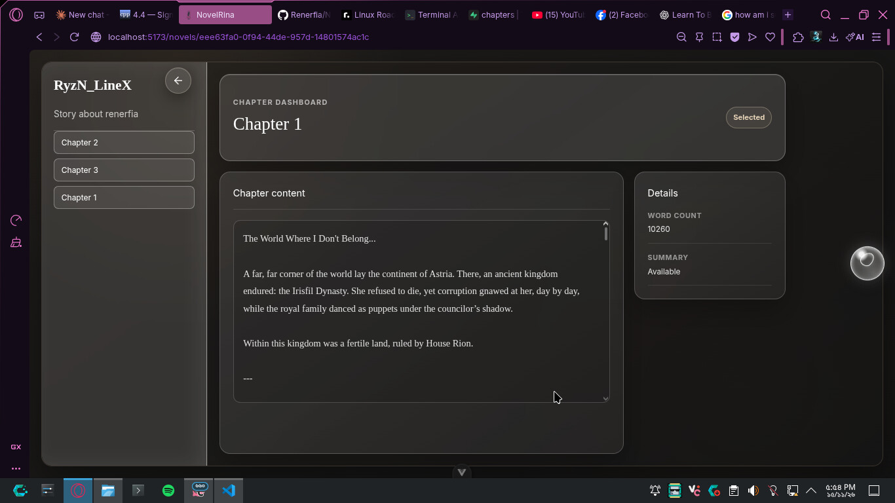
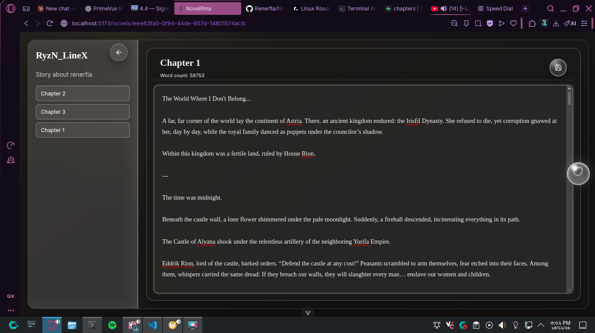
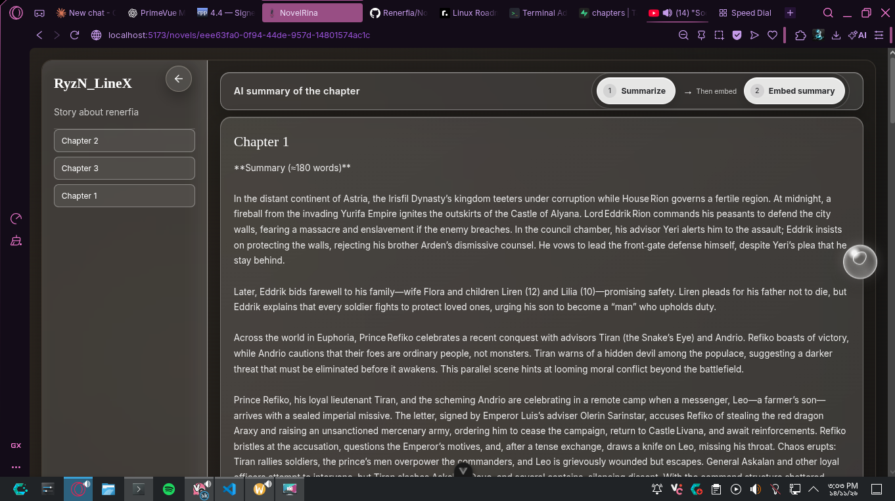
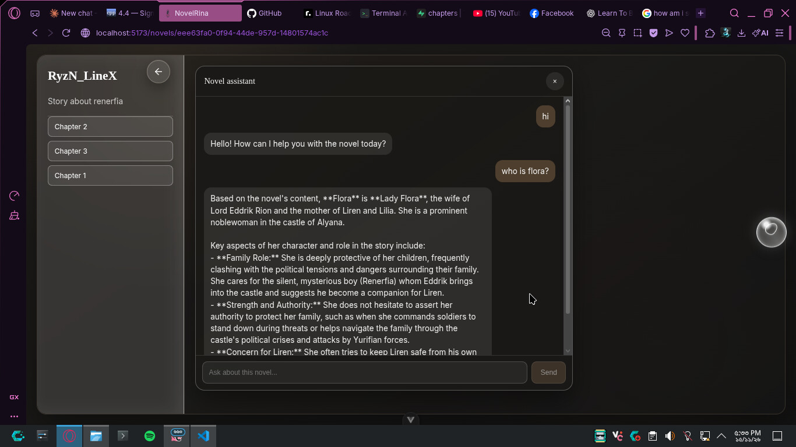
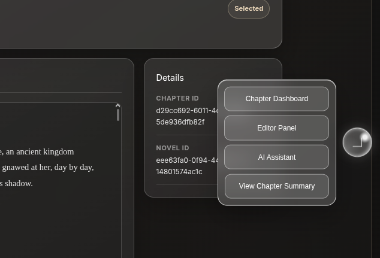

# NovelRina

> **Your stories, organized. Your next idea, one conversation away.**

NovelRina is a writing workspace for managing novels and chapters, editing drafts, generating chapter summaries, and chatting with an AI assistant grounded in your story.

## A closer look

| Your writing home | A focused editor |
|:---:|:---:|
|  |  |

| AI chapter summaries | Chat with your story |
|:---:|:---:|
|  |  |

*Select the AI chat preview to open the video demo.*

## Made for the writing process

- **Keep your work together** — organize novels and chapters in one workspace.
- **Stay in the flow** — edit chapters in a dedicated writing interface.
- **Find the thread again** — generate AI summaries of your chapters.
- **Explore your story** — chat with an AI assistant about your novel.

## Get started

NovelRina runs as two applications during local development. Follow each guide for requirements, environment variables, and deployment instructions:

- [Frontend setup and deployment](./frontend/README.md) — Vue 3, TypeScript, and Vite.
- [Backend setup and deployment](./backend/README.md) — FastAPI service for summaries and novel chat.

The frontend uses Supabase for authentication and data access. The backend verifies Supabase user tokens and connects to Supabase and AI providers. By default, the frontend expects the backend at `http://localhost:8000`.
